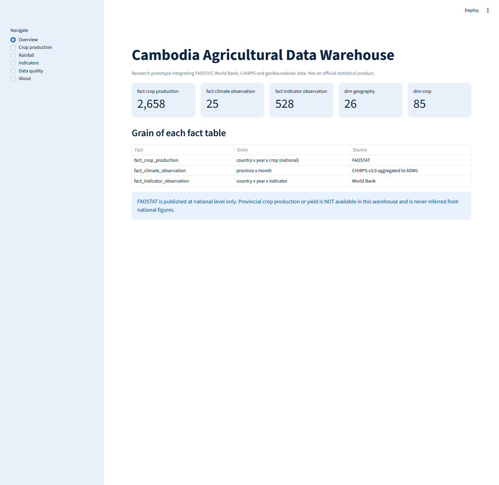
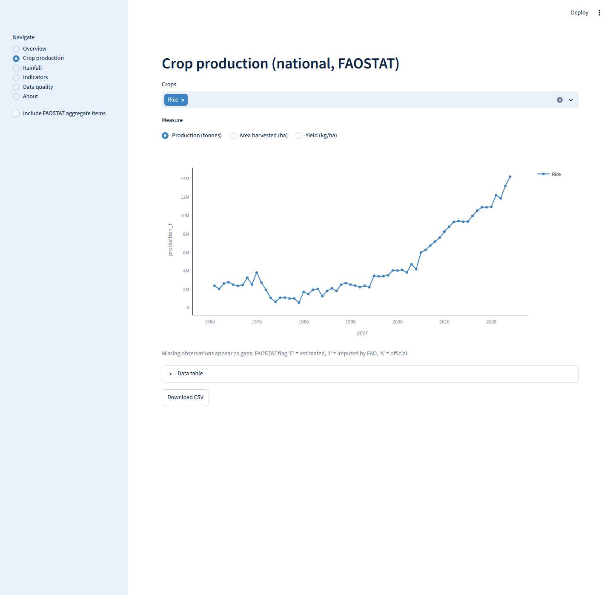
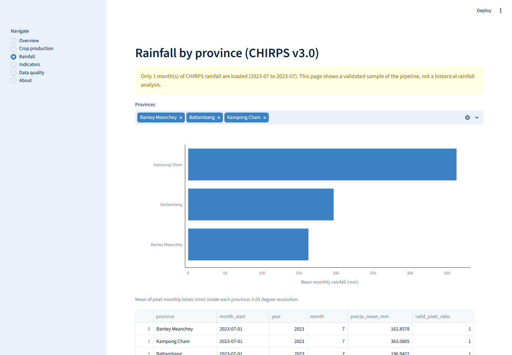
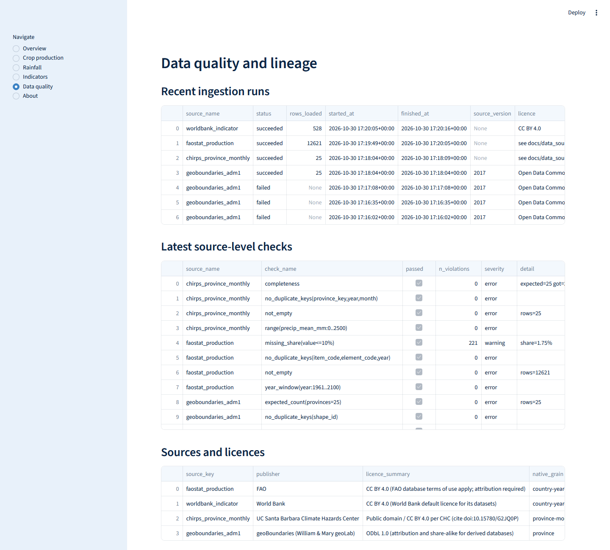

# Cambodia Agricultural Data Warehouse

A research prototype that integrates public agricultural, climate and development data for Cambodia into a
tested PostgreSQL star schema (Bronze, Silver, Gold), built with Python, dbt and Prefect and explored through a
Streamlit dashboard.

> **Scope.** National FAOSTAT crop statistics, World Bank indicators, CHIRPS rainfall aggregated to provinces,
> and province boundaries. **There are no provincial crop statistics here and none are inferred.**
> This is a research prototype (release `v0.1.0`), not an official statistical product.
>
> **Rainfall coverage.** Only **one month of CHIRPS rainfall (July 2023) has been loaded and validated**. The
> pipeline can ingest a longer window, but this repository makes **no claim of a complete historical rainfall
> analysis**.

## Why this exists

Real data work starts before modelling: sources arrive in different formats, units, geographic levels and time
steps. This project asks whether such sources can be integrated into one consistent, documented and tested
structure without mixing incompatible grains. It is the data-infrastructure foundation for later agricultural
forecasting work.

## What is in the warehouse

| Fact table | Grain | Source | Rows (validated run) |
|---|---|---|---|
| `fact_crop_production` | country x year x crop item | FAOSTAT | 2,658 |
| `fact_indicator_observation` | country x year x indicator | World Bank | 528 |
| `fact_climate_observation` | province x month | CHIRPS v3.0 | 25 (**one month sampled**) |

Dimensions: `dim_date`, `dim_year`, `dim_geography` (country + 25 provinces), `dim_crop` (85 FAOSTAT items),
`dim_indicator`, `dim_data_source`. Architecture diagrams are in [docs/architecture.md](docs/architecture.md).

## Validation status

Every figure comes from an executed run on 2026-10-31 (full unedited output:
[reports/validation_2026-10-31_dbt-1.11.16.md](reports/validation_2026-10-31_dbt-1.11.16.md)). An earlier run on
a dbt pre-release is kept as [a superseded record](reports/validation_2026-10-31_dbt-1.13.0b1_superseded.md).

### Tested (executed, with results)

| Check | Result |
|---|---|
| Unit + repository-hygiene tests (no database) | 32 passed |
| Database integration + dashboard tests (live PostgreSQL 17.5) | 13 passed |
| `dbt test` (dbt-core 1.11.16 stable, dbt-postgres 1.11.0) | 42 / 42 passed |
| Independent Gold verification (`scripts/verify_gold.py`) | 31 / 31 passed |
| Lint (`ruff`) | clean |
| Dashboard visual review (desktop, Edge headless, all six pages) | done; defects found and fixed (see below) |
| Data loaded and validated | FAOSTAT 12,621 rows, World Bank 528 rows, 25 provinces, **CHIRPS one month (2023-07)** |

### Not tested or not claimed

| Item | Status |
|---|---|
| **Docker** (`Dockerfile`, `docker-compose.yml`) | **Written but never built or run.** Docker is not installed on the development machine. Treat as untested |
| **GitHub Actions workflow** (`.github/workflows/ci.yml`) | **Never executed.** The first run (2026-10-31) failed to start: GitHub reported *"The job was not started because your account is locked due to a billing issue."* This is an account-level block, not a test failure, so there is **no CI result**. The same checks pass locally (see above); CI will be confirmed once the account issue is resolved and the workflow re-run |
| Rainfall beyond July 2023 | **Not loaded, not validated.** No historical rainfall analysis is claimed |
| Mobile layout of the dashboard | Not reviewed |
| Linux and macOS | Not run locally. Lock files were captured on Windows; CI installs from `requirements.txt` |

The visual review found and fixed unreadable sidebar text in dark mode (now a forced light theme), raw column
names on chart axes, and a missing sample-only warning on the Rainfall page.

### Dashboard (research prototype, localhost)

| Overview | Crop production (national, FAOSTAT) |
|---|---|
|  |  |

| Rainfall (one-month sample, with warning) | Data quality and lineage |
|---|---|
|  |  |

See [docs/limitations.md](docs/limitations.md) for the full list of limitations.

## Quick start

Requirements: Python 3.11+, PostgreSQL 15+ (developed on 17), internet access. No paid services or API keys.

```bash
# 1. environments (dbt is kept apart because dbt and prefect pin conflicting dependencies)
python -m venv .venv      && .venv/Scripts/python -m pip install -r requirements.txt
python -m venv .venv-dbt  && .venv-dbt/Scripts/python -m pip install -r requirements-dbt.txt
# (use .venv/bin/ instead of .venv/Scripts/ on Linux or macOS)

# 2. database: edit the password in scripts/setup_database.sql, then run it once as the postgres superuser
psql -h localhost -U postgres -f scripts/setup_database.sql

# 3. configuration: copy the template and put the password in .env (never in .env.example)
cp .env.example .env

# 4. run the pipeline on a small sample first (one CHIRPS month)
export CADW_CHIRPS_SAMPLE_MONTHS='["2023-07"]'
python -m cadw.cli init-db
python -m cadw.cli run          # ingest -> quality gate -> Bronze -> dbt seed/run/test

# 5. verify and explore
python scripts/verify_gold.py
streamlit run app/streamlit_app.py
```

Load the full rainfall window only after the sample passes: unset `CADW_CHIRPS_SAMPLE_MONTHS` and set
`CADW_CHIRPS_START_YEAR` / `CADW_CHIRPS_END_YEAR` (each month takes roughly 4 to 14 seconds). CHIRPS rasters
are streamed and never stored.

Run `python -m cadw.cli run --sources faostat worldbank --no-dbt` to ingest selected sources only.

## Tests

```bash
pytest                       # unit + hygiene tests, no database or network
pytest -m db                 # database integration + dashboard smoke tests (needs .env)
pytest -m network            # live CHIRPS read (needs internet)
ruff check src tests app scripts
DBT_PROFILES_DIR=dbt .venv-dbt/Scripts/dbt test --project-dir dbt
```

## Repository layout

```
src/cadw/          ingestion (FAOSTAT, World Bank, CHIRPS, boundaries), quality checks, warehouse, Prefect flow, CLI
sql/               idempotent DDL for schemas, Bronze tables and audit tables
dbt/               Silver and Gold models, seeds, 8 singular + generic tests
app/               Streamlit dashboard
scripts/           database setup, independent Gold verification, data-dictionary generator
tests/             unit, hygiene, database and dashboard tests
docs/              architecture, methodology, data sources, limitations, data dictionary
reports/           validation evidence
```

## Data and licences

No data is committed; it is downloaded by the code. Source licences (FAOSTAT CC BY 4.0, World Bank CC BY 4.0,
CHIRPS public domain / CC BY 4.0, geoBoundaries ODbL 1.0) and attribution text are in
[docs/data_sources.md](docs/data_sources.md). The code is MIT licensed (see [LICENSE](LICENSE)).

## Security and privacy

Uses public data only. No National Institute of Statistics data, company data or personal data is included.
Credentials live in a git-ignored `.env`; tests fail if a password or secret pattern is tracked.

## Author

Thy Chantha: Data Science graduate in Applied Mathematics and Statistics, Institute of Technology of Cambodia.
