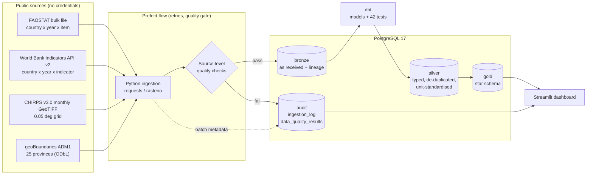
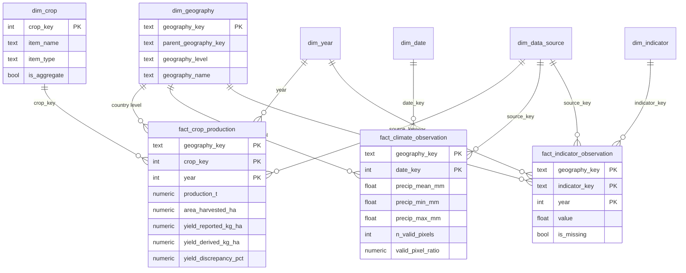

# Architecture

## 1. System overview

CHIRPS rasters (about 21 MB per month, 12 GB for the full archive) are **not stored**. Each month is read
through GDAL's HTTP range reader, only the Cambodia window is decoded, and per-province statistics are
written to Bronze. Bronze therefore holds province aggregates for CHIRPS, not raw pixels.

## 2. Layers

| Layer | Schema | Contents | Written by | Rule |
|---|---|---|---|---|
| Bronze | `bronze` | Source data as received (text for FAOSTAT) plus `_batch_id`, `_loaded_at` | Python | No business logic. Full refresh per source inside one transaction (all or nothing) |
| Silver | `silver` | Typed, de-duplicated, unit-standardised staging tables | dbt | Blank source values stay NULL, never imputed |
| Gold | `gold` | Dimensional model for analysis | dbt | Explicit grain per table; primary keys enforced |
| Audit | `audit` | Ingestion log (URL, checksum, version, licence, status) and per-batch quality results | Python | Every Bronze row traces to a batch via `_batch_id` |

## 3. Gold star schema

### Grain, stated explicitly

| Fact | Grain | Why this grain |
|---|---|---|
| `fact_crop_production` | country x year x crop item | FAOSTAT publishes national figures only |
| `fact_climate_observation` | province x month | CHIRPS is gridded, so it can be aggregated to provinces |
| `fact_indicator_observation` | country x year x indicator | World Bank indicators are national |

Facts at different grains are never joined to produce a finer-grained result. In particular, **no
provincial crop production or yield exists in this warehouse**, and none is derived from national data.

## 4. Deviations from the original design brief (and why)

| Brief | Implemented | Reason |
|---|---|---|
| Separate `FactAgriculturalArea` | Merged into `fact_crop_production` | Area harvested, production and yield come from the same FAOSTAT record set at the same grain; a separate fact would duplicate keys with no analytical benefit |
| `DimClimate` | Not built | Only one climate variable (precipitation) is loaded; the measures stay as columns on the fact |
| Slowly changing dimensions "where justified" | Not implemented | Only one boundary vintage (geoBoundaries 2017) exists; a Type 2 history would record changes that never happened |
| Temperature | Not loaded | No verified temperature source was integrated in this iteration |

## 5. Design choices

- **Hash surrogate keys** (`md5(level || '|' || natural_id)`) make keys deterministic, so a reload never
  reshuffles keys that other tables reference.
- **Aggregate items flagged.** FAOSTAT mixes individual crops with group items (codes 1700 and above,
  such as "Cereals, primary"). `dim_crop.is_aggregate` prevents double counting; the dashboard hides
  them by default.
- **Quality gate before load.** A source that fails an error-severity check is not loaded and the flow
  fails. Missing values are *warnings* because they are legitimate in official statistics.
- **Idempotent, atomic loads.** Each Bronze load truncates and reloads inside one transaction; a failed
  load leaves the previous data intact (covered by an integration test).
- **dbt in its own virtualenv.** dbt and Prefect pin conflicting dependencies; keeping them apart avoids
  an unresolvable environment.

## 6. Reference

Kimball, R. and Ross, M. (2013). *The Data Warehouse Toolkit: The Definitive Guide to Dimensional
Modeling*, 3rd ed. Wiley. ISBN 978-1-118-53080-1. (Source of the grain-first, star-schema approach used here.)
